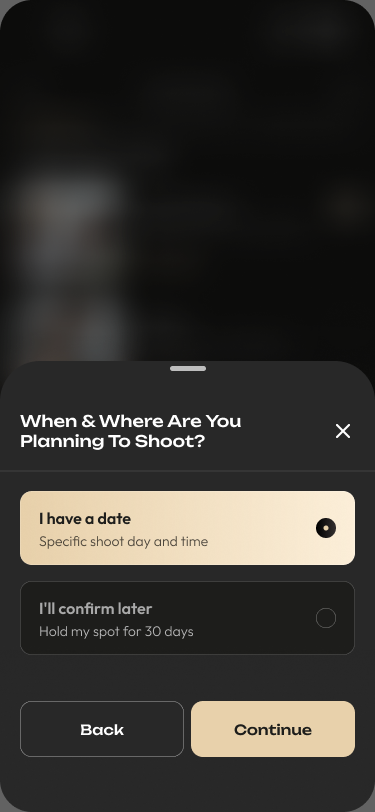
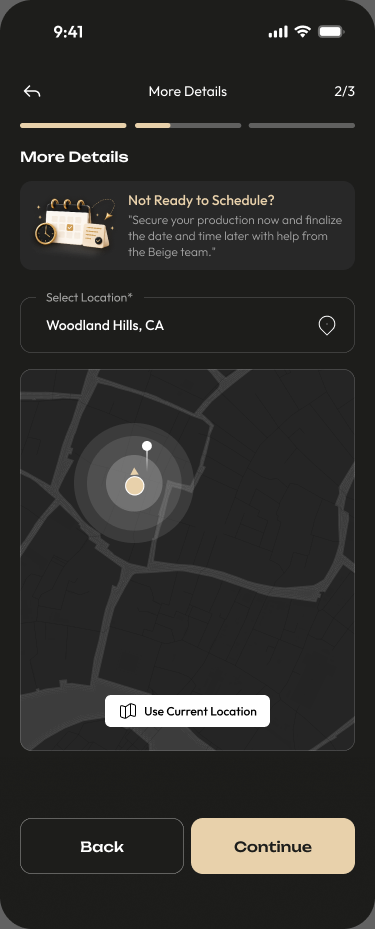
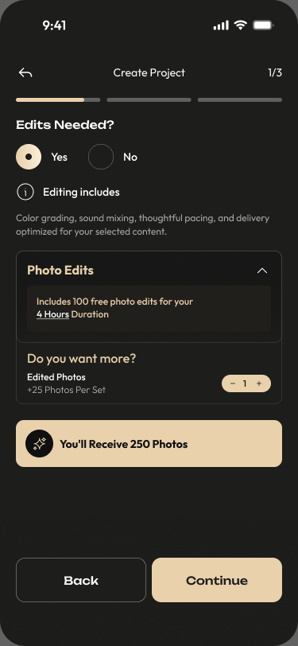
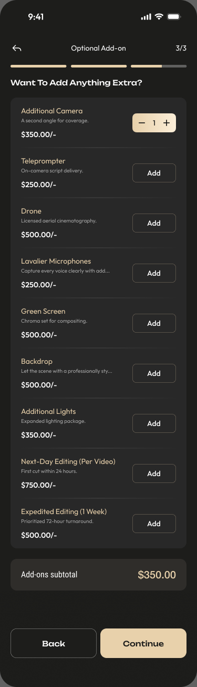

# Booking flow: Figma comparison and additional flows

Reviewed: 5 October 2026  
Status: Initial visual analysis; implementation has not started.

> **Implementation source of truth:** [Final phased booking implementation plan](booking-implementation-plan.md) reconciles this analysis with [api_flow.pdf](api_flow.pdf). Use that plan for screen order, payloads, matching behavior, and payment sequencing. The proposals and open API questions below record the earlier Figma review and are superseded wherever the final plan resolves them.

## Sources and scope

- [Customer app design page](https://www.figma.com/design/P0Loe0Kc4jWEIUBrXGQ6wp/Beige-App-Design?node-id=7343-9965).
- [New Booking Flow V1 — labelled updated 29 September 2026](https://www.figma.com/design/P0Loe0Kc4jWEIUBrXGQ6wp/Beige-App-Design?node-id=7343-65455).
- [Requested When & Where screen](https://www.figma.com/design/P0Loe0Kc4jWEIUBrXGQ6wp/Beige-App-Design?node-id=12815-5106).
- Current Flutter routes, booking screens, and payment handling in this repository.

The findings below distinguish observed designs and code from proposed behavior. Screen order is inferred from the Figma arrangement and names; prototype transitions and backend support have not been verified. Screenshots are local snapshots of the Figma frames, not app screenshots. This is a flow review, not a pixel-by-pixel or runtime audit.

## Current app flow

Content type → Shoot type → Date/time and editing options → Shoot details/location → Crew-size recommendation → Crew selection → Review & Confirm → Commas checkout → Payment confirmation → My Shoots.

The scheduling screen already supports single-day and multiple-day bookings, shared or individual times, and editing selections. Booking management has separate summary, rescheduling, review, and cancellation routes.

Relevant implementation:

| Area | Source |
|---|---|
| Booking routes | [router.dart](../../../lib/app/router.dart), [route_names.dart](../../../lib/app/route_names.dart) |
| Schedule, editing selection, validation and payload | [shoot_date_time_screen.dart](../../../lib/features/booking/presentation/screens/shoot_date_time_screen.dart) |
| Location and project details | [shoot_details_screen.dart](../../../lib/features/booking/presentation/screens/shoot_details_screen.dart) |
| Crew selection | [crew_selection_screen.dart](../../../lib/features/booking/presentation/screens/crew_selection_screen.dart) |
| Review and checkout entry | [shoot_review_screen.dart](../../../lib/features/booking/presentation/screens/shoot_review_screen.dart) |
| Payment status | [booking_review_notifier.dart](../../../lib/features/booking/presentation/providers/booking_review_notifier.dart) |
| Payment failure | [payment_failed_screen.dart](../../../lib/features/booking/presentation/screens/payment_failed_screen.dart) |
| Booking management | [manage_shoot_screen.dart](../../../lib/features/shoot/presentation/screens/manage_shoot_screen.dart) |

## Observed changes in Figma

| Area | Figma design | Difference from current code |
|---|---|---|
| Editing | Dedicated “Edits Needed?” screen before scheduling choice | Editing options currently live inside the date/time screen |
| Scheduling choice | Bottom sheet with “I have a date” and “I’ll confirm later” | No corresponding choice or deferred-date booking route found |
| Deferred date | “Hold my spot for 30 days,” followed by location-only details | Existing scheduled submission requires date/time; a separate branch and data contract are needed |
| Add-ons | Dedicated optional equipment/editing extras screen before review | No corresponding add-ons route found |
| Checkout | Review design contains Stripe/card labels | Main review CTA currently opens Commas checkout; payment copy should match the intended provider |

### 1. When & Where choice

[Figma frame: 12815:5106](https://www.figma.com/design/P0Loe0Kc4jWEIUBrXGQ6wp/Beige-App-Design?node-id=12815-5106)

Observed controls:

- “I have a date” — “Specific shoot day and time.”
- “I’ll confirm later” — “Hold my spot for 30 days.”
- Back, Continue, close icon, and a sheet drag handle.

Proposed behavior: retain the selected option when navigating back; scheduled bookings continue to existing date/time selection; deferred bookings skip date/time and continue to location. Define close, drag-dismiss, and system-back behavior consistently so existing selections are preserved.

### 2. Deferred-date location details

[Figma frame: 12815:5353](https://www.figma.com/design/P0Loe0Kc4jWEIUBrXGQ6wp/Beige-App-Design?node-id=12815-5353)

The design displays “Not Ready to Schedule?” with a message about finalizing date/time later with the Beige team. It asks for location and includes a map and current-location action.

The downstream path is not established by this frame. Before implementation, decide whether the customer selects a provisional crew, receives a team-assisted reservation, or proceeds without crew selection. Availability cannot be treated as confirmed without a date.

### 3. Separate editing step

[Figma frame: 13348:4100](https://www.figma.com/design/P0Loe0Kc4jWEIUBrXGQ6wp/Beige-App-Design?node-id=13348-4100)

The screenshot contains Yes/No editing controls, included photo edits, an extra-photo quantity control, and a delivery total.

Two design issues need resolution:

- Included edits reference a four-hour duration even though this step appears before date/time selection. Decide whether duration is chosen earlier, a package defines it, or the allowance remains provisional until scheduling.
- The sample shows 100 included photos and one extra set of 25, while the total says 250 photos. Those values do not reconcile; use one calculation for selection, review, and checkout.

Reuse the existing editing selection logic where appropriate, but separate its persistence and validation from mandatory scheduling fields.

### 4. Optional add-ons

[Figma frame: 12820:27140](https://www.figma.com/design/P0Loe0Kc4jWEIUBrXGQ6wp/Beige-App-Design?node-id=12820-27140)

The design lists additional camera, teleprompter, drone, lavalier microphones, green screen, backdrop, additional lights, next-day editing, and expedited editing. It includes an add-ons subtotal.

Proposed behavior: allow continuing with zero extras, preserve quantities on back navigation, and include selections in the review and server-calculated price. Confirm quantity limits, compatibility rules, and whether editing-speed options are mutually exclusive. Treat Figma prices as design examples until the backend catalog is agreed.

The “Expedited Editing (1 Week)” label conflicts with its “Prioritized 72-hour turnaround” description. Confirm the actual delivery promise before implementation.

## Proposed booking structure

1. Content type.
2. Shoot type.
3. Editing selection, with the duration/allowance dependency resolved.
4. When & Where choice.
5. Branch:
   - **I have a date:** single/multiple dates and times → shoot details/location → crew recommendation and selection.
   - **I’ll confirm later:** location-only details → reservation/crew behavior to be defined.
6. Optional add-ons, subject to eligibility for the chosen branch.
7. Review showing the selected schedule mode, editing, extras, and itemized pricing.
8. Checkout and explicit paid, failed, or awaiting-confirmation state.
9. Booking details; deferred bookings expose a way to finalize scheduling.

Figma groups the journey under three stages (Create Project, More Details, Book & Confirm). Keep those groupings consistent even when adding screens; they are different from individual screen counts and analytics step numbers.

## Additional screens and states to design

These are proposed requirements, not claims that the inspected Figma frames already define them.

| State | Content and action needed |
|---|---|
| Deferred booking review | “Date to be confirmed,” reservation terms, what is included, and amount due now |
| Deferred booking confirmation | Clear distinction between reservation and confirmed scheduled shoot; deadline and next action |
| Deferred booking in My Shoots | Status, deadline, and “Confirm date” or team-contact action |
| Finalize schedule | Date/time selection, availability recheck, any price difference, and confirmation |
| No availability for selected date | Alternative date or crew path that preserves the reservation |
| Hold expiry | Explain reservation status and available next action based on agreed policy |
| Payment pending | Persistent status and safe status recheck rather than only a temporary message |
| Payment failure | Retry/change-payment route that preserves booking context |

Current payment handling polls the backend up to five times following checkout success. If still pending, it displays “Still confirming your payment. Check My Shoots shortly.” The failure screen says to try again but only provides “Back to Home.” These are existing app recovery gaps, separate from the deferred-date design.

## Product and backend decisions required

1. What does the 30-day hold reserve: price, production capacity, a named crew, or only a booking request?
2. Is payment required immediately? If so, is it a deposit or full payment?
3. When does the 30-day period start, and does it limit the confirmation date or the actual shoot date?
4. Who finalizes the date: the customer, the Beige team, or both?
5. What happens at expiry or cancellation, including any refund or credit?
6. How are duration, editing allowances, and price determined without a confirmed schedule?
7. Can deferred bookings select crew and add-ons before availability is known?
8. Does switching schedule mode retain prior dates as a draft or clear them after confirmation?

Backend support has not been verified. The contract needs an explicit schedule mode, optional schedule fields for deferred bookings, a server-owned deadline/status, and a later scheduling operation. Field names are to be agreed. Do not send dummy dates to satisfy the existing scheduled payload.

## Implementation outline

1. Agree reservation rules and API contract; resolve editing math and delivery-copy inconsistencies.
2. Extract editing into its own screen while preserving existing scheduled-booking behavior.
3. Add the When & Where sheet and persist schedule mode in the booking draft/restoration path.
4. Add deferred location submission and the agreed downstream crew/reservation branch.
5. Add the extras catalog, selection persistence, and server pricing integration.
6. Update review, payment states, confirmation, and My Shoots for deferred bookings.
7. Implement later scheduling, availability conflicts, and expiry behavior.
8. Extend analytics for the new branches without silently changing existing funnel meanings; see [booking analytics plan](../../booking-analytics-plan.md).

## Acceptance and verification checklist

- [ ] Existing single-day and multi-day bookings still submit correctly.
- [ ] Both schedule choices navigate correctly; back/dismiss/re-entry preserve intended state.
- [ ] Deferred submission works without fabricated date/time values.
- [ ] Editing choices survive navigation and totals match review/server pricing.
- [ ] Changing duration recalculates included edits according to the agreed rule.
- [ ] Extras support zero selections, quantity limits, persistence, and applicable compatibility rules.
- [ ] Review clearly distinguishes deferred reservations from scheduled shoots.
- [ ] Payment pending and failure have recoverable paths and do not encourage duplicate payment.
- [ ] My Shoots exposes deferred status and the correct confirmation deadline.
- [ ] Later scheduling handles crew availability conflicts and price changes.
- [ ] Expiry follows server state and the agreed timezone/policy.
- [ ] Guest/login transitions and cold-start restoration preserve the new booking fields.
- [ ] Widget/logic tests cover the new branches; exercise complete scheduled and deferred journeys against the agreed API.

## Reference assets

The four PNGs in [references/](references/) were exported from Figma during this review. Keep the stable frame links above as the source references; exported screenshots may become outdated as the design changes.
