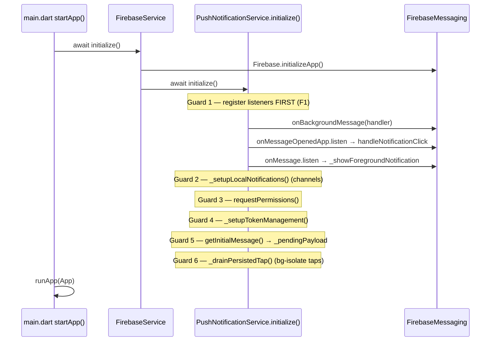
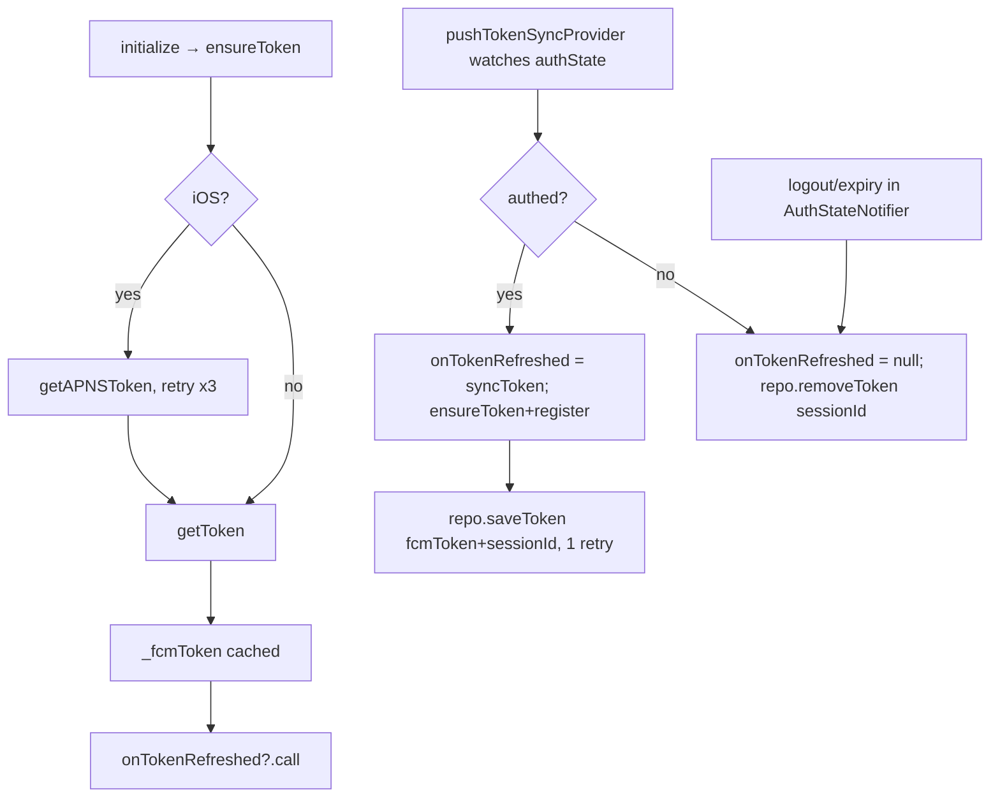
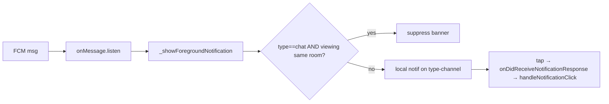
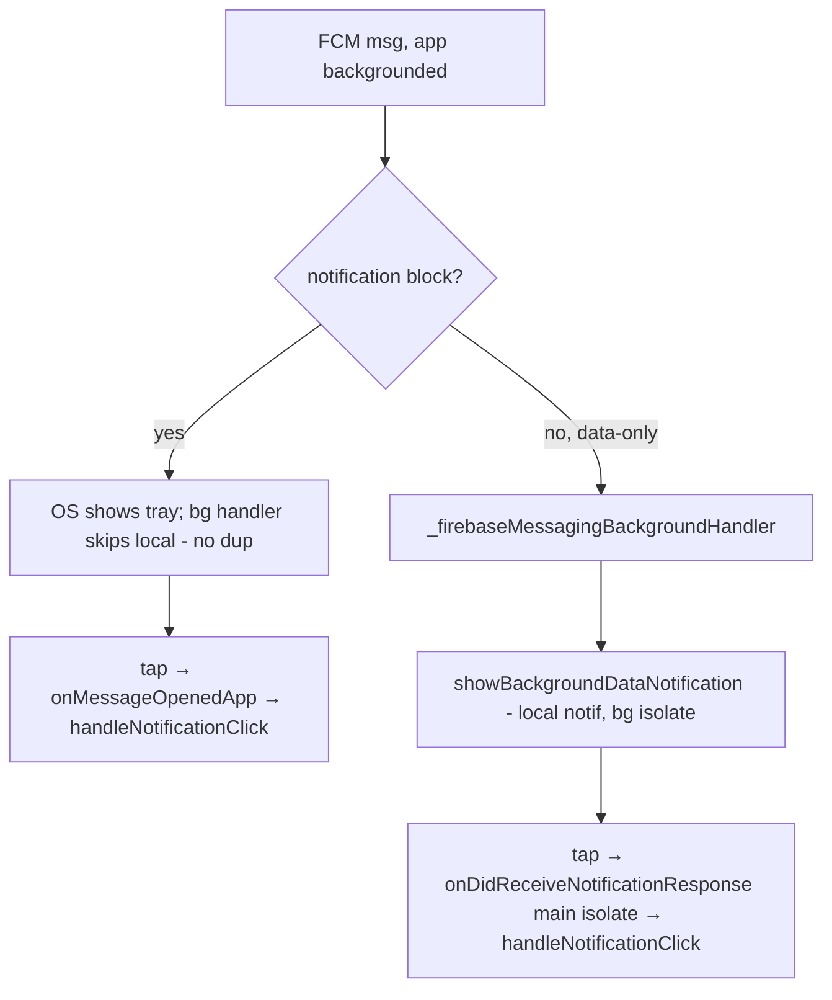
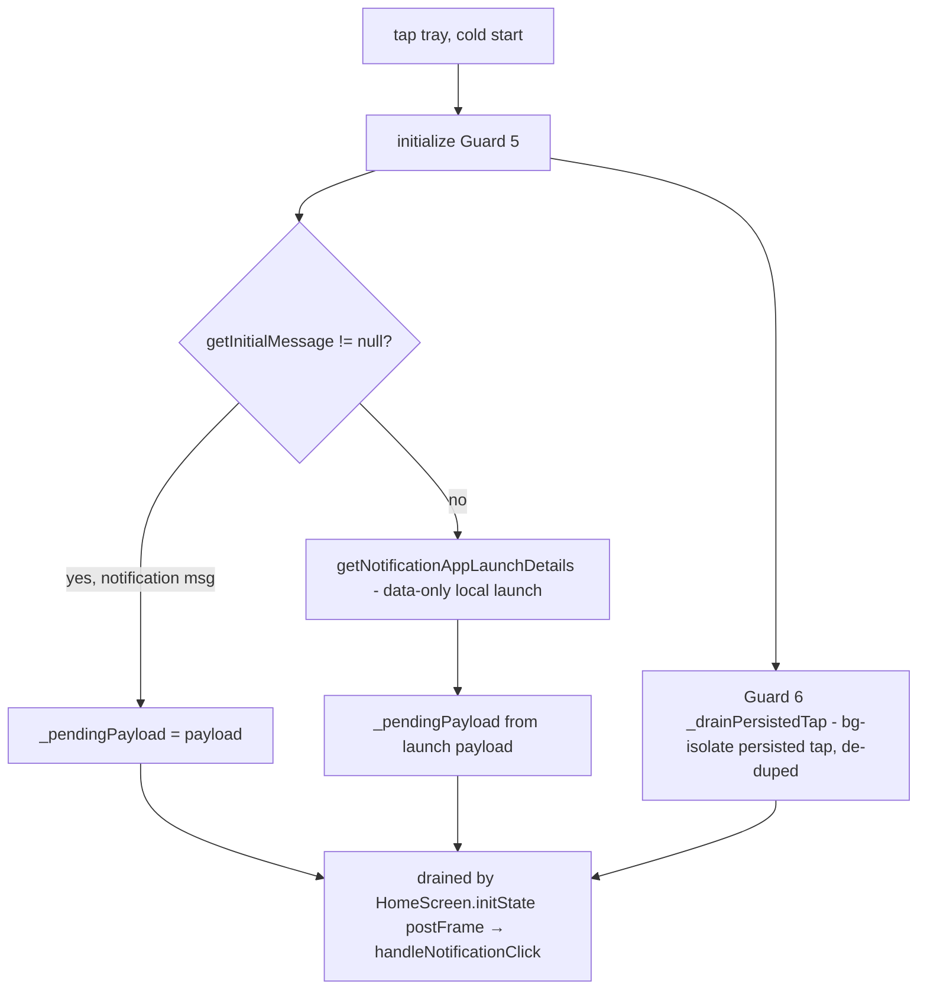
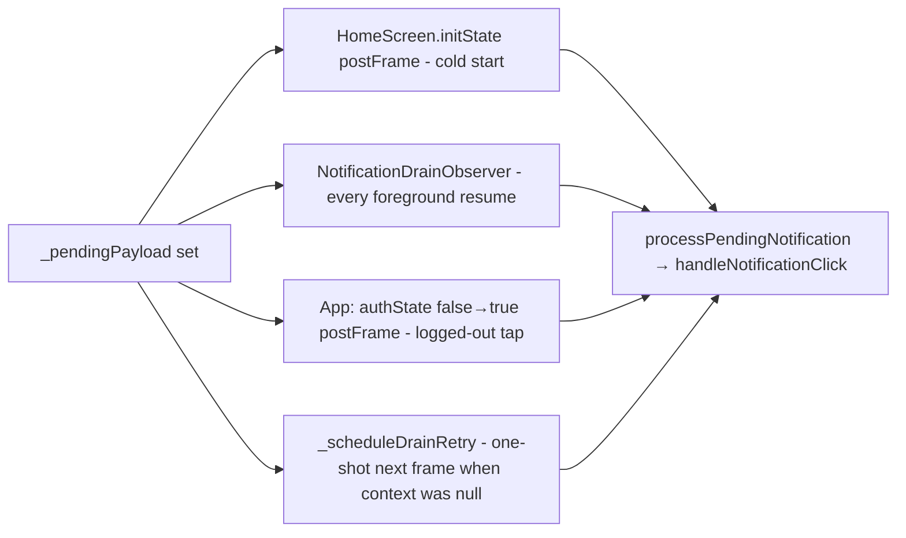
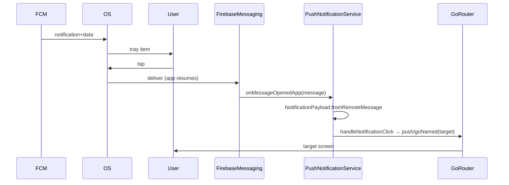

# Firebase Push Notification — Implementation Flow

> Status: reflects code as of commit `1846bd1` (F1–F4 applied, 2026-11-19).
> Scope: FCM push delivery + tap redirection across foreground / background /
> killed on Android & iOS. iOS F3 (UIScene tap delivery) pending on-device verify.

## 1. Components

| Layer | File | Role |
|-------|------|------|
| Service (singleton) | `lib/core/notifications/push_notification_service.dart` | FCM + local-notification orchestration, routing |
| Payload model | `lib/core/notifications/notification_payload.dart` | Parses FCM `data` → typed `NotificationPayload` |
| Resume drain | `lib/core/notifications/notification_drain_observer.dart` | Flushes queued taps on foreground resume |
| Token sync | `lib/core/notifications/push_token_sync_provider.dart` | Registers/deregisters FCM token vs auth |
| Session id | `lib/core/notifications/push_session_id.dart` | Stable per-install id for token registration |
| Auth glue | `lib/core/providers/auth_state_provider.dart` | Deregisters token on logout/expiry |
| Boot | `lib/main.dart` → `lib/core/firebase/firebase_service.dart` | Calls `initialize()` before `runApp` |
| App root | `lib/app/app.dart` | Mounts token sync, drain observer, auth-drain |
| Router | `lib/app/router.dart` + `route_names.dart` | `rootNavigatorKey`, target routes |
| Android native | `android/app/src/main/AndroidManifest.xml` + `res/drawable/ic_stat_notification.xml` | Default channel/icon/color, launcher |
| iOS native | `ios/Runner/AppDelegate.swift`, `Info.plist`, `*.entitlements` | UIScene, APNs env, background modes |

## 2. Message shapes (drives all behavior)

FCM sends one of two shapes. Behavior per app-state depends on which:

- **Notification message** — has a `notification{}` block (+ optional `data`). OS renders the tray item automatically when backgrounded/killed.
- **Data-only message** — only `data{}`. OS renders nothing; the app must build a local notification itself.

> ⚠️ For reliable redirection in **all 6 cells** (fg/bg/killed × Android/iOS), the backend should send **notification-shape** (notification + data). Data-only is lost on **iOS when killed** (platform limitation — iOS won't wake the app) and on **iOS background** unless `content-available: 1` is set.

## 3. Startup / init sequence

`startApp()` awaits `FirebaseService.initialize()` **before** `runApp`, so terminated-launch capture is populated before the first screen builds.

**F1 invariant:** each step is its own `try/catch`. A throw in local-notif setup or the permission prompt is logged and swallowed — it can no longer skip the redirect listeners registered in Guard 1.

## 4. Token lifecycle

- Session id: `PushSessionId.getOrCreate()` (persisted); remembered in-memory (`rememberSession`) so logout can deregister after prefs wipe.
- Register on: initial fetch, `onTokenRefresh`, and auth→true.
- Deregister on: explicit logout (network DELETE while JWT valid) and the logged-out branch of `pushTokenSyncProvider`. Session-expiry (401) skips the network DELETE.

## 5. Delivery per app-state

### 5.1 Foreground (both platforms)

- iOS: `setForegroundNotificationPresentationOptions(alert:false, sound:false)` suppresses FCM's own banner so only the app's local notification shows (no duplicate).
- Active-chat suppression via `_isViewingSameChatRoom` (checks router is on `/chat` with matching `conversationId`).

### 5.2 Background (app alive)

- iOS data-only requires `content-available: 1` or the background handler never runs.

### 5.3 Killed / terminated

- **iOS + killed + data-only = lost** (platform; use notification-shape).
- Android data-only killed works: bg isolate wakes, shows local notif, launch-details captures the tap.

## 6. Pending-payload drain (F2)

A tap can be captured before the navigator is ready. It is queued in `_pendingPayload` and flushed by **four** triggers (all idempotent — `processPendingNotification` clears before dispatch, so only the first wins):

Re-queue conditions inside `handleNotificationClick`: `rootNavigatorKey.currentContext == null`, or router still on `/splash` (auth redirect not settled). Both re-store `_pendingPayload`; the triggers above re-attempt.

## 7. Payload parsing (`NotificationPayload`)

Type resolved by family matching — `data['type']`/`notification_type` first, then `data['topic']`/`category` fallback (so new backend event names keep routing):

| Resolved type | Matched by (examples) |
|---------------|-----------------------|
| `chat` | `chat`, `message*`, `messaging*`, `mention`; topic `messages`/`chat` |
| `booking` | `booking*`, `shoot*`, `order`; topic `shoots`/`bookings` |
| `meeting` | contains `meeting`; topic `meetings` |
| `files` | `*_files_*`, `files_*`, `revision_*`, delivered/approved/uploaded; topic `files` |
| `profile` | `profile*`, `account*`; topic `profile`/`account` |
| `deeplink` | `deeplink`, `route` |
| `unknown` | fallthrough |

ID extraction uses alias lists, e.g. `chatId` ← `chat_room_id`/`room_id`/`roomId`/`chatId`/`chat_id`/`conversationId`; `bookingId` ← `booking_id`/`bookingId`/`shoot_id`/`project_id`/`order_id`; `targetRoute` ← `targetRoute`/`route`/`filepath`.

## 8. Redirection map (`handleNotificationClick`)

Wrapped in try/catch → on any failure `_safeGoHome`. Splash guard re-queues; context-null re-queues + schedules retry.

| Type | Has id? | Navigation |
|------|---------|-----------|
| chat | chatId | `pushNamed(chat, extra:{conversationId, contactName})` |
| chat | — | `goNamed(messages)` |
| booking | numeric bookingId | `pushNamed(manage_booking, path:{bookingId}, extra:{projectName,imageUrl,location,eventDate,start/endTime,contentType})` |
| booking | — / non-numeric | `goNamed(my_shoots)` |
| meeting | meetingId | `goNamed(meetings, query:{meetingId})` |
| meeting | bookingId | `pushNamed(manage_booking, path:{bookingId})` |
| meeting | — | `goNamed(meetings)` |
| files | targetRoute `/file-manager*` | `push(targetRoute)` |
| files | — | `pushNamed(file_manager)` |
| profile | — | `goNamed(profile)` |
| deeplink/unknown | targetRoute `/…` | `push(targetRoute)` else `goNamed(home)` |

## 9. Android native config

- 4 channels created at init: `beige_chat_channel` (max), `beige_booking_channel` (high), `beige_meeting_channel` (high), `beige_general_channel` (default). Channel chosen per payload type.
- Manifest: default channel `beige_general_channel`, icon `ic_stat_notification`, color `@color/notification_accent`; `MainActivity` `exported` + `singleTop` + LAUNCHER intent; `POST_NOTIFICATIONS` permission (Android 13+ runtime request at init).
- Background data-only notifications are built by a fresh plugin instance in the background isolate, re-creating the needed channel.

## 10. iOS native config

- **UIScene lifecycle**: `Info.plist` `UIApplicationSceneManifest` → `FlutterSceneDelegate`. `AppDelegate` adopts `FlutterImplicitEngineDelegate`; plugins register in `didInitializeImplicitFlutterEngine`.
- `aps-environment`: `development` (`Runner.entitlements`) / `production` (`RunnerRelease.entitlements`).
- `UIBackgroundModes`: `fetch`, `remote-notification`.
- firebase_messaging method-swizzling enabled (no `FirebaseAppDelegateProxyEnabled=false`), so it sets the `UNUserNotificationCenter` delegate automatically.
- Foreground presentation suppressed (§5.1) to avoid duplicate banners.
- APNs token fetched with 3× retry before FCM `getToken` on iOS.

## 11. Background tap capture (F4)

`_onDidReceiveBackgroundNotificationResponse` (top-level `@pragma('vm:entry-point')`) runs in the background isolate — no UI, so it cannot navigate. It persists the tapped payload to SharedPreferences (`pendingTapPrefsKey`). On next launch, `_drainPersistedTap()` reads+clears it into `_pendingPayload`, **only if** the FCM `getInitialMessage`/launch-details capture didn't already set one (de-dup). Registered on both `initialize`'s plugin and the background-isolate plugin.

## 12. Known limitations

| # | Limit | Mitigation |
|---|-------|-----------|
| L1 | iOS + killed + data-only push → never delivered | Backend sends notification-shape for iOS-critical events |
| L2 | iOS + background + data-only needs `content-available:1` | Backend sets the flag |
| L3 | iOS UIScene tap delivery to firebase_messaging unverified on-device (F3) | Phase 4 device test; add `SceneDelegate` forwarding if it fails |
| L4 | No `PushNotificationService` unit tests | Needs DI seam for the singleton (FCM/local-notif + static listeners) |

## 13. End-to-end tap sequence (background, notification-shape)

